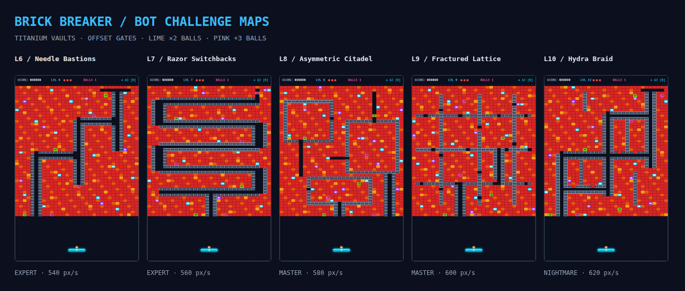
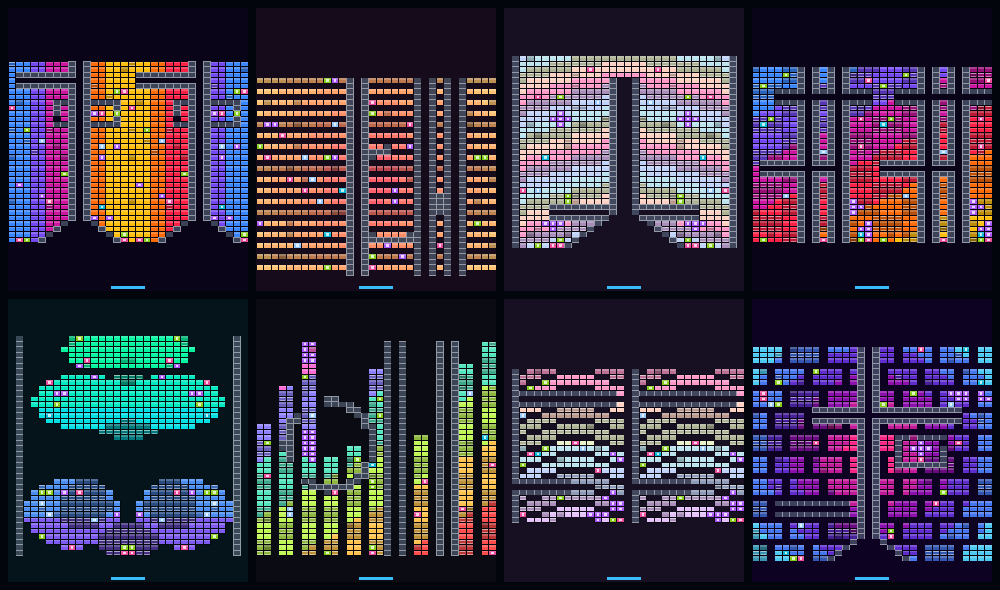

# 🧱 Brick Breaker — Chute & Corridor Arcade

A lightweight, high-performance Brick Breaker web game built with **Pure HTML5 Canvas and Vanilla JavaScript (Zero Runtime Dependencies)**. Featuring dense, challenging level designs with narrow vertical corridors inspired by viral satisfying brick-breaker gameplay, paired with an autonomous predictive AI bot.

---

## 🌟 Key Features

- **🎮 Satisfying Corridor Gameplay**: Balls penetrate narrow 15px vertical chutes and 11px horizontal passages flanked by indestructible slate walls, triggering rapid ricochets through dense brick vaults.
- **🤖 Autonomous AI Bot (Hotkey: `B`)**: Predictive bot using analytical trajectory raycasting, modular wall reflection folding, and obstacle lookahead. It saves incoming balls first and catches falling bonuses when there is time to return safely. Opposing simultaneous arrivals can still cost balls.
- **🗺️ Ten Maps**: The original five corridor maps plus five harder bot challenges with dense titanium armor, offset gates, layered vaults, and faster launches (540–620 px/s).
- **🎲 Endless Random Maps**: A seeded generator composes every map from 14 field motifs (rings, spiral, waves, skyline, pixel-art sprites, …), 3 symmetry modes, 9 wall structures (chutes, funnels, vaults, orbit rings, …), bomb fuses, powerups, and 12 color palettes. The same seed always rebuilds the same map; an endless run never repeats a layout, and neighbouring maps never share a motif or palette. Every map is checked so walls never seal a brick.
- **💣 Chain Reactions**: A bomb caught in a blast detonates 0.07 s later, so touching bombs roll across the field as a cascade.
- **🛡️ Shield Bonuses**: Break a blue `S` brick and catch its falling capsule to raise an energy floor for 9 s (stacking to 18 s); balls bounce off it instead of being lost.
- **🟢 ×2 / 🩷 +3 Multiball**: Break lime `×2` or pink `+3` bricks, including with bombs, to release falling capsules. Catch them with the paddle to double the active ball count or add three balls. Missing a capsule gives no bonus. Both types appear in every new challenge map.
- **↗️ Straight Ball Physics**: Balls travel straight between collisions, including while the bot is active.
- **⚡ Ultra Lightweight & High Performance**: 60 FPS silky smooth gameplay in modern browsers with zero third-party npm runtime dependencies. Headless simulation throughput exceeds **14,000 FPS**.
- **🔊 Procedural Web Audio API**: Dynamic retro sound synthesizer generating sound effects for wall bounces, brick destruction, chute ricochets, bomb explosions, and victory fanfares without external audio files.
- **💥 Multi-Tier Brick Physics**:
  - **Amber (1 Hit)**: Standard breakable brick.
  - **Orange (2 Hits)**: Reinforced brick.
  - **Crimson (3 Hits)**: Titanium armor brick.
  - **Slate (Indestructible)**: Guide rails and corridor walls.
  - **Cyan (+15% Speed)**: Speed booster trigger.
  - **Purple (Bomb)**: 3x3 explosive blast radius.
  - **Lime (×2)**: Drops a capsule that doubles active balls when caught, subject to the ball limit.
  - **Pink (+3)**: Drops a capsule that adds three balls when caught, subject to the ball limit.
  - **Blue (Shield)**: Drops a capsule that raises an energy floor for 9 s when caught.
- **☁️ Cloud & Colab Ready**: Clean decoupled architecture separating game simulation/physics state from canvas rendering, making it straightforward to run headless on Google Colab or connect automated gameplay recorders.

---

## 🕹️ Controls & Hotkeys

| Action | Control / Hotkey |
|---|---|
| **Steer Paddle** | Mouse slide, Touch drag, <kbd>←</kbd> / <kbd>→</kbd>, or <kbd>A</kbd> / <kbd>D</kbd> |
| **Launch Ball** | <kbd>Space</kbd>, Mouse Click, or Tap Screen |
| **Toggle AI Bot** | <kbd>B</kbd> or Click **AI BOT** button |
| **Pause / Resume** | <kbd>P</kbd> or <kbd>Esc</kbd> |
| **Restart Level** | <kbd>R</kbd> |
| **New Random Map** | <kbd>N</kbd> or the **🎲 NEW MAP** button |
| **Mute / Unmute** | <kbd>M</kbd> |
| **Select Level** | Dropdown menu (L1 to L10, plus 🎲 Random · Chill / Normal / Hard) |

---

## 🗺️ Levels & Level Design

1. **Level 1: The Central Chute**: Matches the reference video layout with a narrow central vertical shaft leading into a massive top brick vault.
2. **Level 2: Dual Corridors & Twin Bastions**: Twin vertical express chutes flanking a heavily fortified center stronghold.
3. **Level 3: The City Matrix**: A dense grid of intersecting vertical and horizontal shafts connecting four major junction plazas.
4. **Level 4: The Alpine Serpentine**: A challenging 3-tier S-curve switchback tunnel with 180° turnaround pockets.
5. **Level 5: The Gauntlet**: Triple micro-chutes, heavy ablative titanium plating, and core bomb pockets.
6. **Level 6: The Needle Bastions (EXPERT)**: Offset one-column entry chutes and armored bastions require repeated precision breaches.
7. **Level 7: The Razor Switchbacks (EXPERT)**: Five horizontal galleries alternate their openings between opposite flanks.
8. **Level 8: The Asymmetric Citadel (MASTER)**: Three vaults use staggered doorways and uneven armor to disrupt straightforward trajectories.
9. **Level 9: The Fractured Lattice (MASTER)**: Offset lattice doors and crossbars force repeated changes of route through reinforced chambers.
10. **Level 10: The Hydra Braid (NIGHTMARE)**: Interleaved siege routes, tight gates, and repeated multiball bursts form the final swarm challenge.

The challenge maps use the existing 4.5 px ball radius: a one-column vertical channel is 15 px wide and a one-row horizontal passage is 11 px high. The level validator expands permanent walls by the ball radius and checks that every challenge-map breakable has a reachable impact position. This checks geometry; it does not guarantee that the bot wins every map.



Catch falling capsules with the paddle to activate their bonuses. The default maximum is **32 active balls**, configurable with `ball.maxBalls`. If a collected bonus would exceed that limit, it adds only the available slots. A dropped ball is removed; a life is lost only after the last ball disappears. Restarting or changing maps clears falling capsules and resets the swarm to one ball while preserving the existing score/lives/bot rules.

---

## 🎲 Random Maps & Autoplay



Pick **🎲 Random** in the level menu (or press <kbd>N</kbd>). Clearing a map generates the next one, carrying score and lives over. Each map shows its name, recipe, and seed on a title card. Maps already played in this browser are skipped (stored in `localStorage`).

URL options make runs shareable and scriptable:

| Parameter | Effect |
|---|---|
| `?seed=K7Q2-M9XD` | Start (or replay) the endless run with this seed. The address bar is kept in sync. |
| `&difficulty=chill` | `chill`, `normal` (default), or `hard`. |
| `&bot=1` | Start with the AI bot on. |
| `&fixed=1` | Step the simulation in exact 1/60 s ticks. With `bot=1`, Chromium plays the run tick for tick like the headless autoplay in Node (checked: same score and ball positions at frame 551), which is what a recorder needs. Other browser engines may round trig functions differently. |
| `?level=3` | Open a campaign level directly. |

`window.brickBreaker` exposes the app for automation, e.g. `brickBreaker.engine.startRandomRun({ seed: 'abc', difficulty: 'chill' })`.

### Map lab CLI

```bash
# 8 maps from one run seed, as a contact sheet
npm run mapgen -- --count 8 --seed DEMO-2026 --sheet out/maps/sheet.png

# 5 chill maps the bot clears within 90 s, saved as JSON + PNG thumbnails
npm run mapgen -- --count 5 --difficulty chill --require-clear --max-seconds 90 --out out/maps --png

# Never reuse a map across runs: skip and record fingerprints in a history file
npm run mapgen -- --count 10 --history out/maps/history.json
```

Each saved JSON is a complete level definition (layout, palette grid, theme, recipe, fingerprint, and the autoplay summary when `--simulate` ran), so a renderer can draw it without re-running the generator.

### Library API

```js
import { generateMap, MapSequence } from './src/core/map_generator.js';
import { simulateLevel } from './src/core/autoplay.js';

const map = generateMap({ seed: 'K7Q2-M9XD/1', difficulty: 'normal' }); // deterministic
const run = new MapSequence({ seed: 'K7Q2-M9XD', difficulty: 'chill' });  // endless, non-repeating
const result = simulateLevel(run.next(), { maxSeconds: 120 });            // bot plays headlessly
// result: { cleared, seconds, percent, maxBalls, longestChain, ballsLost, ... }
```

Use `npm run test:generated` to measure bot progress with the current physics and collectible bonuses; completion time depends on the seed and difficulty.

---

## 🚀 Quick Start

Serve the project over HTTP so browsers can load the ES modules:
```bash
# Using Python 3
python3 -m http.server 8080

# Or using Node http-server / serve
npx serve .
```
Then navigate to `http://localhost:8080` in your browser.

---

## 🧪 Testing & Verification

The project includes an extensive test suite with zero test dependencies:

```bash
# Original 3,000-frame single-ball bot rally
npm run test:bot

# All-map geometry, powerup placement, and challenge reachability
npm run test:levels

# Unit, adversarial physics, campaign progression, and multiball tests
npm test

# Four-tier integration suite
npm run test:e2e

# 10,000-frame bot run per map, including multiball and life accounting
npm run test:campaign

# Bot clear rate and speed on generated maps for each difficulty
npm run test:generated
```

---

## 📁 Project Structure

```
brick_breaker/
├── index.html                 # Main web arcade interface
├── style.css                  # Responsive arcade styling & dark theme
├── package.json               # Project metadata & test script
├── README.md                  # Project documentation
├── src/
│   ├── config.js              # Global physics and game constants
│   ├── core/
│   │   ├── autoplay.js        # Headless bot run of one level, with summary
│   │   ├── bot.js             # Autonomous trajectory raycasting bot
│   │   ├── clearance.js       # Ball-clearance reachability flood (validator + generator)
│   │   ├── engine.js          # Isomorphic decoupled game engine (campaign + random runs)
│   │   ├── level_manager.js   # Level progression and state tracking
│   │   ├── levels.js          # High-density level matrices (L1–L10)
│   │   ├── map_generator.js   # Seeded procedural maps and endless MapSequence
│   │   ├── map_theme.js       # Palettes and themed brick colors
│   │   ├── physics.js         # CCD, falling bonuses, chain bombs, shields
│   │   ├── rng.js             # Seeded PRNG and seed codes
│   │   └── state.js           # Immutable state management & serialization
│   └── platform/
│       └── browser/
│           ├── audio_synth.js     # Web Audio API sound generator
│           ├── canvas_renderer.js # 60 FPS HTML5 Canvas renderer
│           ├── input_manager.js   # Keyboard, mouse, touch handler
│           └── main.js            # Browser entry point
├── tools/
│   ├── mapgen.js              # Map lab CLI (generate, preview, autoplay-vet, history)
│   └── map_preview.js         # Headless map thumbnails and PNG encoder
└── tests/                     # Comprehensive test & benchmark suites
```

---

## 📄 License
MIT License
